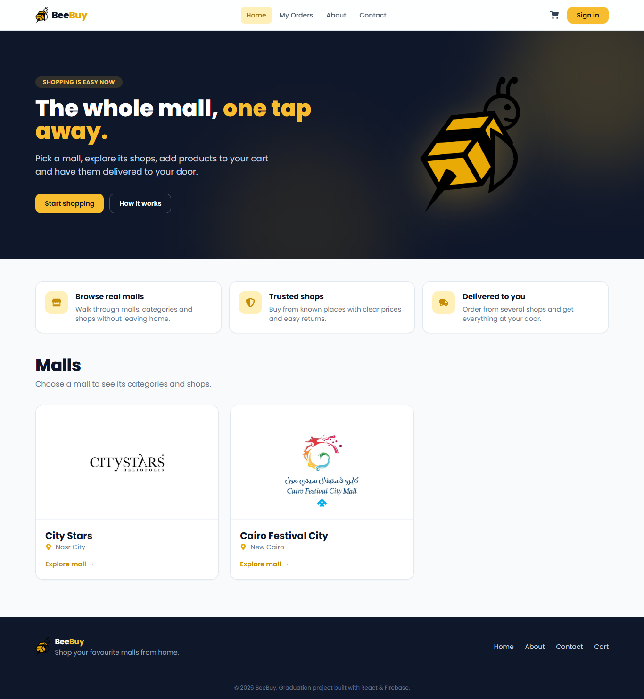

# 🐝 BeeBuy

A mall shopping web app: pick a mall, browse its categories and shops, add products to your cart and place a delivery order.
Built as a graduation project (2023) with **React** and **Firebase**, and later redesigned with **Tailwind CSS**.

**Live demo:** https://ahmmedelsaid.github.io/BeeBuy/

| Desktop | Mobile |
| --- | --- |
|  |  |

## Features

- Browse **malls → categories → shops → products** (data stored in Cloud Firestore)
- Email/password **authentication** with form validation and friendly error messages
- **Cart** synced to Firestore: quantity controls, live totals, delivery fee
- **Checkout** with delivery details and optional "use my location"
- **Order history** with status (pending / packing / delivered)
- Profile page, product search, contact form, toast notifications
- Fully responsive layout, keyboard-accessible controls, graceful image fallbacks

## Tech stack

React 18 · React Router 6 (HashRouter) · Firebase (Auth + Firestore, compat SDK) · Tailwind CSS 3 · react-icons · Create React App

## Project structure

```
src/
  firebase.js        single Firebase initialisation
  context/           Auth, Cart and Toast providers
  layout/            Navbar, Footer, Layout, RequireAuth
  pages/             Home, Categories, Shops, Products, Cart, Orders, Profile, SignIn, About, Contact
  ui/                shared components (Spinner, Breadcrumbs, EmptyState, SafeImage) and hooks
```

## Getting started

```bash
npm install
npm start          # http://localhost:3000
npm test           # unit tests
npm run build      # production build
npm run deploy     # publish the build to GitHub Pages (gh-pages branch)
```

The app uses the Firebase project configured in [`src/firebase.js`](src/firebase.js).
To use your own project, replace that config and create the `malls` collection
(`malls/{id}/Categories/{id}/shops/{id}/products/{id}`), plus `users/{uid}` and `users/{uid}/orders`.

## Notes

- Routing uses `HashRouter` so deep links keep working on GitHub Pages.
- Firebase web config is public by design; protect data with Firestore security rules.
- Product/shop/mall photos used to be stored in Firebase Storage, which is no longer available on the free (Spark) plan.
  Images that are kept in [`public/images`](public/images) are served locally through [`src/imageMap.json`](src/imageMap.json)
  (key = original file name, value = path under `public/`). Any image that can't load falls back to a coloured initials placeholder.
  To add a photo: drop it in `public/images` and add a line to `imageMap.json`.
